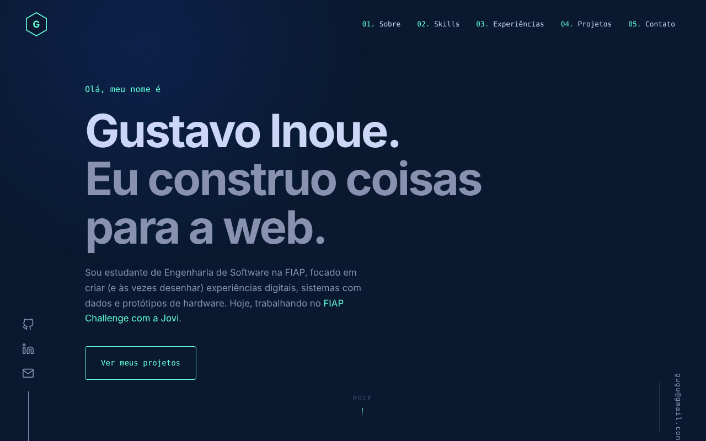

<div align="center">

# Gustavo Inoue — Portfólio

**Landing page pessoal de um estudante de Engenharia de Software, com animações guiadas pelo scroll.**

[Ver online](#-demo) · [Documentação do processo](docs/README.md) · [Contato](#-autor)




</div>

## Sobre o projeto

Portfólio do primeiro ano de Engenharia de Software na **FIAP**, criado para o **Checkpoint 6 — Vibecoding**: construir uma landing page com IA generativa e **documentar o processo** (referências, identidade visual, prompts e correções).

A página reúne skills, experiências e cinco projetos reais, com visual sério e leve e **animações ligadas à posição do scroll**, feitas em CSS puro (sem biblioteca de animação).

## Demo

- **Site:** *(adicionar o link do deploy, ex.: cp-6-front-portifolio.vercel.app
- **Repositório:** https://github.com/GustavoInoue/CP6_Front_Portifolio

## Destaques

- **Scroll-driven animations em CSS** (`animation-timeline`): o hero se dissolve ao rolar, o texto do *Sobre* acende palavra por palavra, a linha do tempo se preenche e os cartões de projeto se empilham.
- **Navegação com scroll-spy:** barra lateral fixa no desktop (a linha do item ativo cresce) e menu em gaveta no celular.
- **Leve:** ~240 kB de JavaScript (75 kB comprimido), sem Three.js nem Framer Motion.
- **Responsivo** de 390 px (celular) a telas largas.
- **Acessível:** navegação por teclado com foco visível e respeito a `prefers-reduced-motion`.
- **Fallback:** em navegadores sem suporte a `animation-timeline`, as seções entram com uma revelação simples via `IntersectionObserver`.
- **Ilustrações SVG autorais** para cada projeto, animadas apenas ao passar o mouse.

## Seções

| # | Seção | Conteúdo |
|---|---|---|
| — | Hero | Apresentação, redes sociais e contato |
| 01 | Sobre | Quem sou e números do primeiro ano |
| 02 | Skills | Front-end, Dados e IA, Hardware, Engenharia de software, Fluxo de trabalho |
| 03 | Experiências | FIAP Challenge (Jovi), Resolução de Problemas Diferenciada, Checkpoint 6 |
| 04 | Projetos | CodeCam, FIREWATCH, Café Aroma, Alarme Residencial, Diagrama de Casos de Uso |
| 05 | Contato | Gmail, LinkedIn e GitHub |

## Tecnologias

- [React 19](https://react.dev/) — interface em componentes
- [Vite](https://vite.dev/) — servidor de desenvolvimento e build
- **CSS puro** — layout, tema e animações de scroll
- [Oxlint](https://oxc.rs/docs/guide/usage/linter) — lint
- **Inter** e **JetBrains Mono** (Google Fonts) — tipografia

## Como rodar

Pré-requisitos: [Node.js](https://nodejs.org/) 20 ou superior.

```bash
# 1. Instale as dependências
npm install

# 2. Rode em modo de desenvolvimento
npm run dev
```

Abra o endereço mostrado no terminal (normalmente `http://localhost:5173`).

### Scripts

| Comando | O que faz |
|---|---|
| `npm run dev` | Servidor de desenvolvimento com recarga automática |
| `npm run build` | Gera a versão de produção na pasta `dist/` |
| `npm run preview` | Serve a versão de produção localmente |
| `npm run lint` | Verifica o código com o Oxlint |

## Estrutura

```
gv-portfolio/
├── docs/                      # Documentação do processo (Checkpoint 6)
│   ├── references/            # Prints de referência
│   └── screenshots/           # Capturas de cada versão
├── public/
├── src/
│   ├── components/
│   │   ├── Nav.jsx            # Barra superior + scroll-spy + progresso
│   │   ├── Sidebar.jsx        # Barra lateral fixa (desktop)
│   │   ├── Hero.jsx · About.jsx · Skills.jsx
│   │   ├── Experience.jsx · Projects.jsx · Contact.jsx · Footer.jsx
│   │   ├── Art.jsx            # Ilustrações SVG dos projetos
│   │   ├── Reveal.jsx         # Fallback de revelação (IntersectionObserver)
│   │   └── Socials.jsx · Icons.jsx
│   ├── data/projects.js       # Todo o conteúdo editável do site
│   ├── hooks/useActiveSection.js
│   ├── App.jsx · App.css      # Composição e estilos
│   ├── index.css              # Tokens de design (cores, fontes) e reset
│   └── main.jsx
└── index.html
```

## Como personalizar

- **Conteúdo** (projetos, skills, experiências e contatos): edite `src/data/projects.js`.
- **Cores e fontes:** variáveis no topo de `src/index.css`.

| Variável | Valor | Uso |
|---|---|---|
| `--bg` | `#0a192f` | Fundo |
| `--bg2` | `#112240` | Cartões |
| `--line` | `#233554` | Bordas |
| `--text` | `#ccd6f6` | Títulos |
| `--slate` | `#8892b0` | Texto corrido |
| `--accent` | `#64ffda` | Destaques e ações |

## Deploy

O projeto é um site estático, ideal para a [Vercel](https://vercel.com/):

1. Suba o repositório no GitHub.
2. Na Vercel, **Add New → Project** e importe o repositório.
3. O framework **Vite** é detectado sozinho (build: `npm run build`, saída: `dist`).

## Compatibilidade

| Navegador | Animações de scroll |
|---|---|
| Chrome / Edge (recentes) | ✅ Completas |
| Safari (versões recentes) | Depende da versão; fallback simples se não houver suporte |
| Firefox | Fallback simples (revelação ao entrar na tela) |

## Documentação do processo

O foco do Checkpoint 6 é o **caminho**, não só o resultado. Tudo está em [`docs/`](docs/README.md), na ordem do enunciado:

1. [Referências visuais](docs/01-referencias.md)
2. [Identidade visual](docs/02-identidade-visual.md) — paleta, tipografia, tom e estrutura
3. [Prompts utilizados](docs/03-prompts.md)
4. [Registro de correções](docs/04-registro-de-correcoes.md)
5. [Resultado final, QA e reflexão](docs/05-resultado-final.md)
6. [Evolução das versões](docs/06-evolucao-das-versoes.md) — incluindo as duas trocas completas de layout

## Referências e créditos

O layout, a paleta e a interação seguem a inspiração do portfólio de [Brittany Chiang](https://brittanychiang.com/). Este projeto é um trabalho acadêmico e **não copia o código** do site original — apenas se inspira em sua organização visual. Mais referências em [`docs/01-referencias.md`](docs/01-referencias.md).

## Autor

**Gustavo Inoue** — estudante de Engenharia de Software na FIAP

- GitHub: [@GustavoInoue](https://github.com/GustavoInoue)
- LinkedIn: [/in/GustavoInoue](https://linkedin.com/in/GustavoInoue)
- E-mail: gugu@gmail.com
